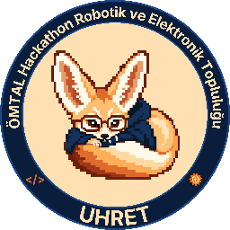
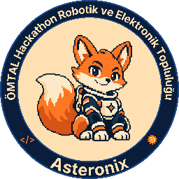
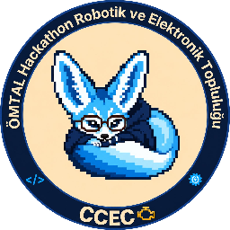
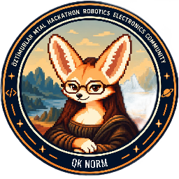
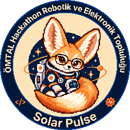

# UHRET

[Türkçe](README.tr.md) · [Official website](https://oztimurlarmtaluhret.tech/)

UHRET is the student-led Hackathon, Robotics and Electronics Community at Öztimurlar Vocational and Technical Anatolian High School in Bursa, Türkiye. It operates under the school’s International Technology Competitions and Project Club.

## NASA Space Apps Challenge 2026 · Bursa

Five UHRET teams took part in Bursa. UHRET’s six project forks are configured to synchronize automatically with their original repositories every hour. Active development takes place upstream.

### ARES Mission Planner

**7Page - UHRET**

A research prototype that compares short and terrain-weighted routes on a map of Jezero Crater. The route weights are illustrative. The prototype has no operational or EVA safety validation.

[UHRET fork](https://github.com/UHRET/ARES-Mission-Control) · [Original repository](https://github.com/baban9999ytr/ARES-Mission-Control) · [NASA team record](https://www.spaceappschallenge.org/2026/find-a-team/7page-uhret/) · [Live demo](https://spcapps.openstacktool.com/)

 

### EarthSona

**Asteronix - UHRET**

A browser app for exploring NASA Earth imagery on a map or globe and turning the imagery into sound. The player samples visible pixels. Quantitative sonification of physical raster values is future work.

[UHRET fork](https://github.com/UHRET/EarthSona) · [Original repository](https://github.com/grassified/EarthSona) · [NASA team record](https://www.spaceappschallenge.org/2026/find-a-team/asteronix-uhret/) · [Live demo](https://earthsona.netlify.app/)

 

### CALY: LEFT BEHIND

**Caly's Check Engine Club - UHRET**

A bilingual visual novel about equipment left behind by Moon and Mars missions, illustrated with NASA archive imagery. The [project catalogue](../docs/PROJECTS.md#caly-left-behind) records asset attribution and the scope of the rights confirmation for both forks.

[UHRET fork](https://github.com/UHRET/caly-full) · [Original repository](https://github.com/Hakanefe25/caly-full) · [Apollo 17 demo · UHRET](https://github.com/UHRET/caly-demo) · [Original demo repository](https://github.com/Hakanefe25/caly-demo) · [NASA team record](https://www.spaceappschallenge.org/2026/find-a-team/calys-check-engine-club/)

 

### QK norm — BlindSpot Explorer

**Qk norm - UHRET**

A prototype for exploring microgravity combustion records and gaps in fire-detection research. Scientific validation is pending.

[UHRET fork](https://github.com/UHRET/QK-norm-UHRET) · [Original repository](https://github.com/eeea2222/QK-norm-UHRET) · [NASA team record](https://www.spaceappschallenge.org/2026/find-a-team/qk-norm-uhret/)

 

### Solar Pulse

**Solar Pulse - UHRET**

An educational prototype for astronaut wellness, exercise and mission planning. The public GitHub repository contains the project description. The implementation and license could not be verified from the public repository.

[UHRET fork](https://github.com/UHRET/solar-pulse) · [Original repository](https://github.com/ilyascinar593-ops/solar-pulse) · [NASA team record](https://www.spaceappschallenge.org/2026/find-a-team/solar-pulse-uhret/)

 

[Project catalogue, sources and limitations](../docs/PROJECTS.md)

## Focus and contributions

We work on software, robotics and electronics and use hackathons and technology competitions to practise research, prototyping and presentation. See each repository for its own contribution guidance or read the [organization contribution guide](../CONTRIBUTING.md). School communities and technical teams can contact us by email about collaboration.

[oztimurlarmtaluhret@gmail.com](mailto:oztimurlarmtaluhret@gmail.com)
