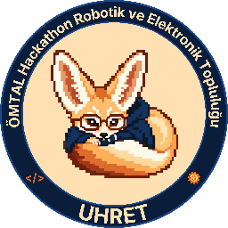
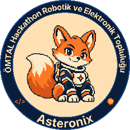
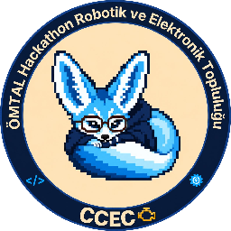
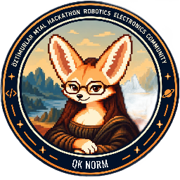
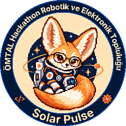

# UHRET

[English](README.md) · [Resmî web sitesi](https://oztimurlarmtaluhret.tech/)

UHRET, Bursa’da Öztimurlar Mesleki ve Teknik Anadolu Lisesi bünyesinde, Uluslararası Teknoloji Yarışmaları ve Proje Kulübü altında çalışan öğrenci liderliğindeki Hackathon, Robotik ve Elektronik Topluluğudur.

## NASA Space Apps Challenge 2026 · Bursa

Beş UHRET takımı, Bursa’da beş projeyle yer aldı. UHRET’in altı proje fork’u, özgün depolarıyla otomatik eşitleme için saatlik olarak yapılandırılmıştır. Aktif geliştirme özgün depolarda yürütülür.

### ARES Mission Planner

**7Page - UHRET**

Jezero Krateri haritasında kısa ve arazi koşullarını gözeten rotaları karşılaştıran araştırma prototipi. Rota ağırlıkları örnek amaçlıdır. Prototip operasyonel kullanım veya araç dışı faaliyet (EVA) güvenliği için doğrulanmamıştır.

[UHRET fork’u](https://github.com/UHRET/ARES-Mission-Control) · [Özgün depo](https://github.com/baban9999ytr/ARES-Mission-Control) · [NASA ekip kaydı](https://www.spaceappschallenge.org/2026/find-a-team/7page-uhret/) · [Canlı demo](https://spcapps.openstacktool.com/)

 

### EarthSona

**Asteronix - UHRET**

NASA’nın yayımladığı Dünya görsellerini tarayıcıda sese dönüştüren, harita ve küre üzerinden keşif yapılabilen uygulama. Oynatıcı görünür pikselleri örnekler. Fiziksel raster değerlerinin nicel olarak seslendirilmesi ileride yapılacak çalışmalar arasındadır.

[UHRET fork’u](https://github.com/UHRET/EarthSona) · [Özgün depo](https://github.com/grassified/EarthSona) · [NASA ekip kaydı](https://www.spaceappschallenge.org/2026/find-a-team/asteronix-uhret/) · [Canlı demo](https://earthsona.netlify.app/)

 

### CALY: LEFT BEHIND

**Caly's Check Engine Club - UHRET**

NASA arşiv fotoğraflarıyla Ay ve Mars görevlerinden geriye kalan ekipmanı anlatan iki dilli görsel roman. [Proje kataloğunda](../docs/PROJECTS.tr.md#caly-left-behind) görsel kaynakları ve iki fork’a ilişkin hak teyidinin kapsamı yer alır.

[UHRET fork’u](https://github.com/UHRET/caly-full) · [Özgün depo](https://github.com/Hakanefe25/caly-full) · [Apollo 17 demosu · UHRET](https://github.com/UHRET/caly-demo) · [Özgün demo deposu](https://github.com/Hakanefe25/caly-demo) · [NASA ekip kaydı](https://www.spaceappschallenge.org/2026/find-a-team/calys-check-engine-club/)

 

### QK norm — BlindSpot Explorer

**Qk norm - UHRET**

Mikro yerçekiminde yanma deneylerini ve yangın algılamadaki araştırma boşluklarını inceleyen prototip. Bilimsel doğrulama henüz tamamlanmadı.

[UHRET fork’u](https://github.com/UHRET/QK-norm-UHRET) · [Özgün depo](https://github.com/eeea2222/QK-norm-UHRET) · [NASA ekip kaydı](https://www.spaceappschallenge.org/2026/find-a-team/qk-norm-uhret/)

 

### Solar Pulse

**Solar Pulse - UHRET**

Astronot sağlığı, egzersiz ve görev planlamasını bir araya getiren eğitim prototipi. GitHub’da proje tanıtımı yayımlanmış durumda. Uygulama kodu ve lisansı herkese açık depodan doğrulanamamıştır.

[UHRET fork’u](https://github.com/UHRET/solar-pulse) · [Özgün depo](https://github.com/ilyascinar593-ops/solar-pulse) · [NASA ekip kaydı](https://www.spaceappschallenge.org/2026/find-a-team/solar-pulse-uhret/)

 

[Proje kataloğu, kaynaklar ve sınırlamalar](../docs/PROJECTS.tr.md)

## Çalışma alanları ve katkı

Yazılım, robotik ve elektronik projeleri geliştiriyoruz. Hackathon ve teknoloji yarışmalarında araştırma, prototipleme ve sunumu birlikte yürütüyoruz. Proje katkıları için ilgili deponun kurallarına, organizasyon çalışmaları için [katkı rehberine](../CONTRIBUTING.md) bakabilirsin. Okul toplulukları ve teknik ekipler iş birliği için bize e-posta gönderebilir.

[oztimurlarmtaluhret@gmail.com](mailto:oztimurlarmtaluhret@gmail.com)
